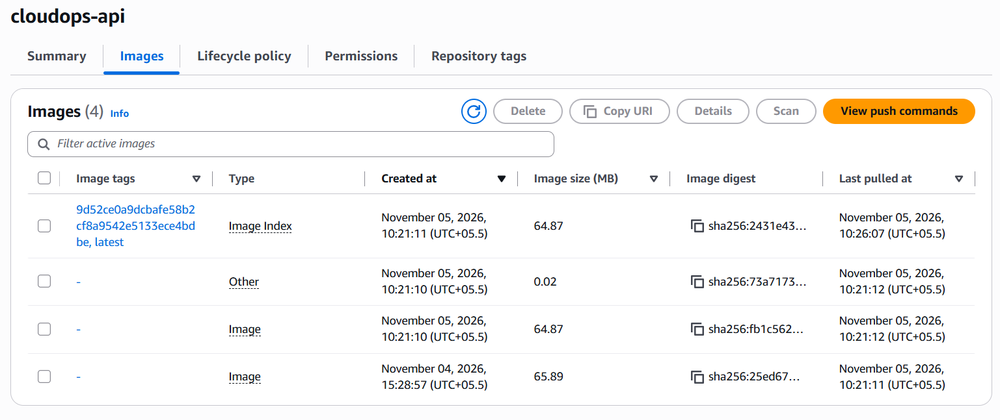
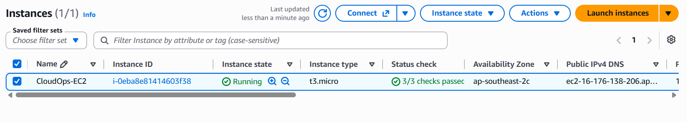
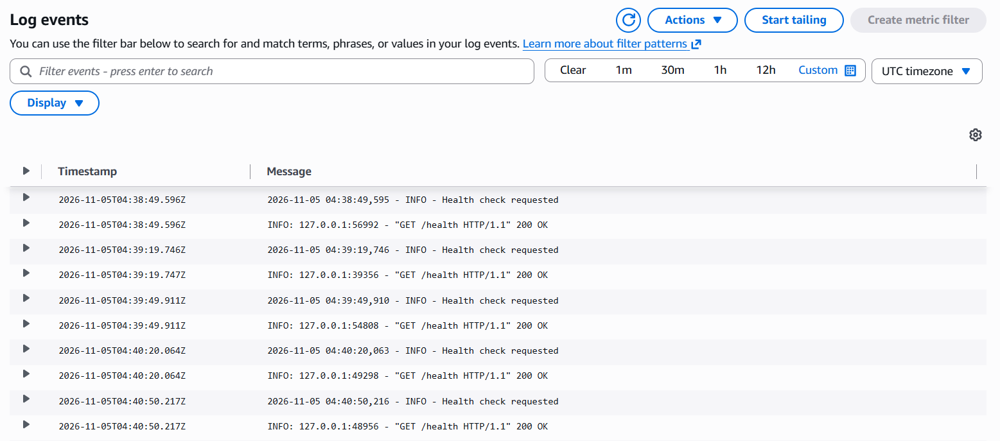
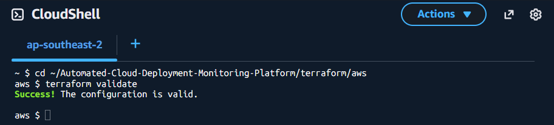

# CloudOps – Automated Cloud Deployment & Monitoring Platform

A beginner-to-intermediate Cloud and DevOps portfolio project demonstrating application development, automated testing, Docker containerization, CI/CD automation, AWS cloud deployment, Infrastructure as Code (IaC), and monitoring.

## Project Overview

CloudOps is a Python-based task management REST API built with FastAPI and SQLite.

The project demonstrates how application development can be combined with modern Cloud and DevOps practices.

It includes automated testing using Pytest, Docker containerization, GitHub Actions CI/CD, Docker image publishing to Docker Hub and Amazon ECR, cloud deployment on AWS EC2, infrastructure management using Terraform, and monitoring through Prometheus, Grafana, and AWS CloudWatch.

The project also implements application logging, health checks, environment-based configuration, test coverage reporting, and Docker image vulnerability scanning with Trivy.

## Architecture


## Technologies Used

| Category | Technologies |
|---|---|
| Backend | Python, FastAPI |
| Database | SQLite |
| API Testing | Pytest, HTTPX |
| Test Coverage | pytest-cov |
| Containerization | Docker, Docker Compose |
| Version Control | Git, GitHub |
| CI/CD | GitHub Actions |
| Container Registries | Docker Hub, Amazon ECR |
| Cloud Platform | AWS |
| Cloud Compute | Amazon EC2 |
| Infrastructure as Code | Terraform |
| Cloud Logging | Amazon CloudWatch Logs |
| Cloud Monitoring | Amazon CloudWatch Metrics |
| Application Monitoring | Prometheus, Grafana |
| Cloud Deployment | AWS EC2, Vercel |
| Security Scanning | Trivy |
| API Documentation | Swagger UI |
| Development Environment | Windows, VS Code |

## Main Features

### 1. Application Development

- REST API development using FastAPI.
- Task management CRUD operations.
- SQLite database integration.
- Interactive API documentation through Swagger UI.
- Application health check endpoint.
- Prometheus metrics endpoint.

### 2. Docker Containerization

- Custom Docker image creation.
- Dockerfile-based application containerization.
- Docker Compose multi-container environment.
- Named Docker volume for persistent SQLite database storage.
- Docker health checks.
- Separate development and production configurations.
- Container restart policies.
- Application logging.

### 3. CI/CD Automation

- Automated workflows using GitHub Actions.
- Automated Pytest execution.
- Docker image building using Docker Buildx.
- Automated Docker Hub image publishing.
- Automated Amazon ECR image publishing.
- Image tagging using `latest` and Git commit SHA.
- AWS authentication using GitHub Secrets.
- Terraform formatting and validation through a separate GitHub Actions workflow.

### 4. AWS Cloud Deployment

- Amazon ECR private container image repository.
- Amazon EC2 deployment using Docker.
- Amazon Linux 2023 environment.
- IAM roles and restricted permissions.
- Security group configuration for controlled network access.
- Persistent Docker volume for SQLite database storage.
- Deployment of updated container images from Amazon ECR.
- Public FastAPI endpoint and Swagger UI access.

**AWS Region:** `ap-southeast-2` (Asia Pacific – Sydney)

### 5. Infrastructure as Code

- Terraform configuration for AWS infrastructure.
- AWS provider configuration.
- Existing EC2 instance imported into Terraform state.
- Existing ECR repository imported into Terraform state.
- Existing security group imported into Terraform state.
- AWS account, VPC, and IAM role data sources.
- Terraform formatting and validation.
- Infrastructure change verification using `terraform plan`.
- Resource protection using Terraform lifecycle rules.

### 6. Monitoring and Observability

**Local monitoring:**
- Prometheus metrics collection.
- Grafana monitoring dashboard.
- API request monitoring.
- API response-time monitoring.
- HTTP status code monitoring.
- API availability monitoring.

**AWS monitoring:**
- CloudWatch application log collection.
- EC2 CPU utilization monitoring.
- Docker application logging integration.

### 7. Container Security

- Docker image vulnerability scanning using Trivy.
- Identification of operating system and Python package vulnerabilities.
- Review of vulnerability severity and available fixes.
- Restricted AWS IAM permissions for image publishing.
- Secure management of CI/CD credentials using GitHub Secrets.

## CI/CD Workflow

The GitHub Actions pipeline automates application testing and Docker image publishing.

1. Developer pushes code to the GitHub `main` branch.
2. GitHub Actions starts the CI/CD workflow.
3. Python dependencies are installed.
4. Pytest runs automated application tests.
5. Docker Buildx builds the application image after successful tests.
6. AWS credentials are configured using GitHub Secrets.
7. The workflow authenticates with Amazon ECR.
8. Docker images are published to Docker Hub and Amazon ECR.
9. Images are tagged with `latest` and the Git commit SHA.

**CI/CD Pipeline:**

GitHub → GitHub Actions → Pytest → Docker Build → Docker Hub + Amazon ECR

The EC2 deployment is updated by manually pulling the latest image from ECR and recreating the Docker container after a successful image publishing workflow.

Vercel is independently connected to the GitHub repository and automatically deploys changes from the `main` branch. Vercel deployment is not gated by the GitHub Actions test job.

### GitHub Actions Workflows

- `ci-cd.yml` – Automated testing, Docker image building, and publishing to Docker Hub and Amazon ECR.
- `terraform-check.yml` – Terraform formatting, initialization, and configuration validation.

## AWS Deployment

The FastAPI application is deployed on an Amazon EC2 instance using a Docker image stored in Amazon ECR.

### AWS Services

| AWS Service | Purpose |
|---|---|
| Amazon EC2 | Hosts the FastAPI application |
| Amazon ECR | Stores Docker container images |
| AWS IAM | Manages service permissions and access |
| Amazon VPC | Provides network infrastructure |
| Security Groups | Controls network access |
| Amazon CloudWatch Logs | Collects application logs |
| Amazon CloudWatch Metrics | Monitors EC2 CPU utilization |

### Deployment Process

1. GitHub Actions builds and publishes the Docker image.
2. Amazon ECR stores the private container image.
3. The EC2 instance authenticates with ECR using its IAM role.
4. The latest image is pulled from ECR.
5. The existing Docker container is replaced with the updated container.
6. The FastAPI application runs on EC2.
7. Application logs are sent to Amazon CloudWatch.
8. Application health is verified through the public API endpoint.

### AWS Application Endpoints

The EC2 deployment exposes the following endpoints on port `8000`:

| Endpoint | Purpose |
|---|---|
| `/` | API welcome endpoint |
| `/health` | Application health check |
| `/docs` | Interactive Swagger documentation |
| `/tasks` | Task management API |
| `/metrics` | Prometheus metrics |

The public endpoint uses the EC2 instance's public IPv4 address. Access is restricted through the configured security group.

## Terraform Infrastructure Management

Terraform is used to describe and manage the existing AWS infrastructure.

The Terraform configuration is located in:

`terraform/aws/`

Current Terraform-managed resources:

- Amazon EC2 instance.
- Amazon ECR repository.
- CloudOps security group.

Additional data sources retrieve AWS account, default VPC, and IAM role information.

The existing AWS resources were imported into Terraform state rather than recreated.

Terraform validation and planning confirmed that the configuration matched the imported infrastructure at the time of verification.

The Terraform GitHub Actions workflow validates configuration formatting and syntax. It does not authenticate to AWS or provision infrastructure.

## Monitoring Architecture

### Local Monitoring

The local monitoring environment uses Docker Compose to run the API, Prometheus, and Grafana.

**Monitoring workflow:**

FastAPI `/metrics` → Prometheus → Grafana

The CloudOps Monitoring Dashboard includes:

- Total API Requests.
- API Request Rate.
- API Response Time (P95).
- HTTP Status Code Distribution.
- API Availability.

### AWS Monitoring

Amazon CloudWatch collects application logs from the EC2-hosted Docker container.

**CloudWatch Log Group:**

`/cloudops/ec2/application`

The project also uses EC2 CPU utilization metrics available through CloudWatch.

This provides visibility into application activity and basic EC2 instance performance.

## Project Structure

```text
CloudOps/
│
├── app/
│   ├── __init__.py
│   ├── main.py
│   └── database.py
│
├── tests/
│   ├── __init__.py
│   └── test_main.py
│
├── monitoring/
│   └── prometheus.yml
│
├── terraform/
│   └── aws/
│       ├── versions.tf
│       ├── provider.tf
│       ├── main.tf
│       ├── outputs.tf
│       └── .terraform.lock.hcl
│
├── .github/
│   └── workflows/
│       ├── ci-cd.yml
│       └── terraform-check.yml
│
├── docs/
│   └── screenshots/
│
├── Dockerfile
├── compose.yaml
├── compose.dev.yaml
├── requirements.txt
├── requirements-lock.txt
├── .env.example
├── .dockerignore
├── .gitignore
├── architecture.png
└── README.md
```

## Running Locally

### Prerequisites

- Python 3.12
- Git
- Docker Desktop (for containerized execution)

### 1. Clone the repository

```bash
git clone https://github.com/hirushifernando/Automated-Cloud-Deployment-Monitoring-Platform.git

cd Automated-Cloud-Deployment-Monitoring-Platform
```

### 2. Create a virtual environment

```bash
python -m venv venv
```

### 3. Activate the virtual environment (Windows PowerShell)

```powershell
.\venv\Scripts\Activate.ps1
```

### 4. Install dependencies

```bash
pip install -r requirements.txt
```

### 5. Run the application

```bash
uvicorn app.main:app --reload
```

Open the following URLs:

- API: http://localhost:8000/
- Health Check: http://localhost:8000/health
- Swagger UI: http://localhost:8000/docs
- Metrics: http://localhost:8000/metrics

## Running with Docker Compose

Make sure Docker Desktop is running.

Start all services:

```bash
docker compose up -d --build
```

### Available Services

| Service | URL |
|---|---|
| FastAPI | http://localhost:8000 |
| Swagger UI | http://localhost:8000/docs |
| Prometheus | http://localhost:9090 |
| Grafana | http://localhost:3000 |

### Stop the services

```bash
docker compose down
```

The named SQLite data volume is preserved when using this command.

## Development Configuration

A separate development configuration is available through `compose.dev.yaml`.

To validate the merged configuration:

```bash
docker compose -f compose.yaml -f compose.dev.yaml config
```

To start with the development configuration:

```bash
docker compose -f compose.yaml -f compose.dev.yaml up -d --build
```

## Automated Testing

Run the test suite:

```bash
pytest -v
```

Run tests with coverage:

```bash
pytest --cov=app --cov-report=term-missing -v
```

### Test Results

- Automated tests: 10
- Tests passed: 10
- Application code coverage: 100%

The coverage report includes both `app/main.py` and `app/database.py`.

## Docker Image Security Scanning

Trivy was used to scan the Docker image for known vulnerabilities.

The scan examined:

- Operating system packages.
- Installed Python packages.
- Vulnerability severity levels.
- Available fixed versions.

The scan identified findings in packages including `zlib1g` and `pip`. These findings were reviewed as part of the project's container security assessment.

## Screenshots

### API Documentation


### API Task Creation


### Docker Containers


### Docker Hub Repository


### GitHub Actions CI/CD Pipeline


### Amazon ECR Repository



### Amazon EC2 Deployment



### AWS CloudWatch Logs



### Terraform Infrastructure Validation



### Prometheus Monitoring


### Grafana Monitoring Dashboard


### Vercel Cloud Deployment


## Project Limitations

- The Vercel deployment uses SQLite, which does not provide persistent database storage across deployments or instances. It is intended as a demonstration deployment.
- Prometheus and Grafana are configured for local monitoring through Docker Compose.
- The local Prometheus configuration monitors the local API container, not the Vercel or AWS deployment.
- Docker Hub and Amazon ECR image publishing are automated through GitHub Actions.
- EC2 container replacement is currently performed manually after a successful image push.
- Terraform validation is automated, but infrastructure provisioning is not currently performed by GitHub Actions.
- The project is a learning and portfolio implementation rather than a production-grade cloud platform.

## Future Improvements

- Automated EC2 deployment after successful ECR publishing.
- Terraform-driven infrastructure provisioning through a secure cloud authentication setup.
- PostgreSQL database integration.
- Automated container vulnerability scanning in CI/CD.
- Advanced DevSecOps integration.
- Enhanced cloud monitoring and alerting.
- Improved deployment rollback and recovery strategies.

## Author

**Hirushi Fernando**

Computer Science Graduate | AI & ML Enthusiast | Cloud & DevOps Learner
