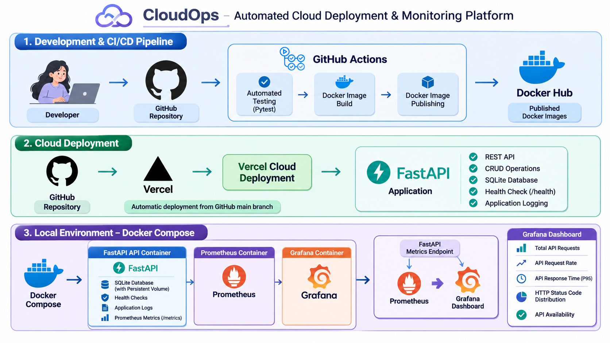
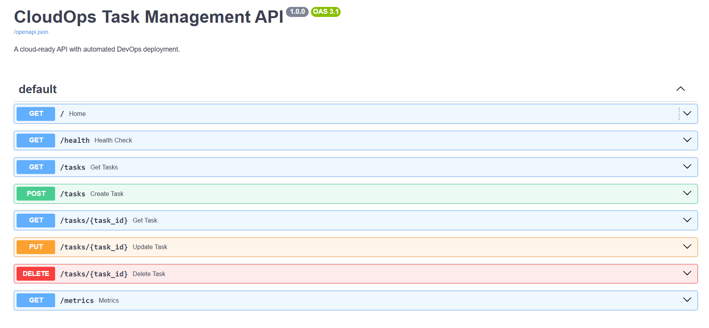
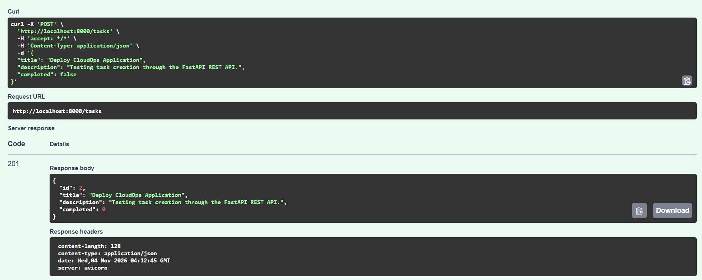
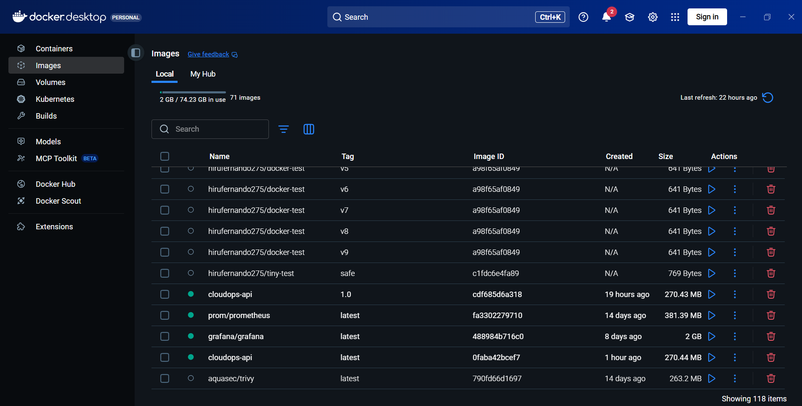
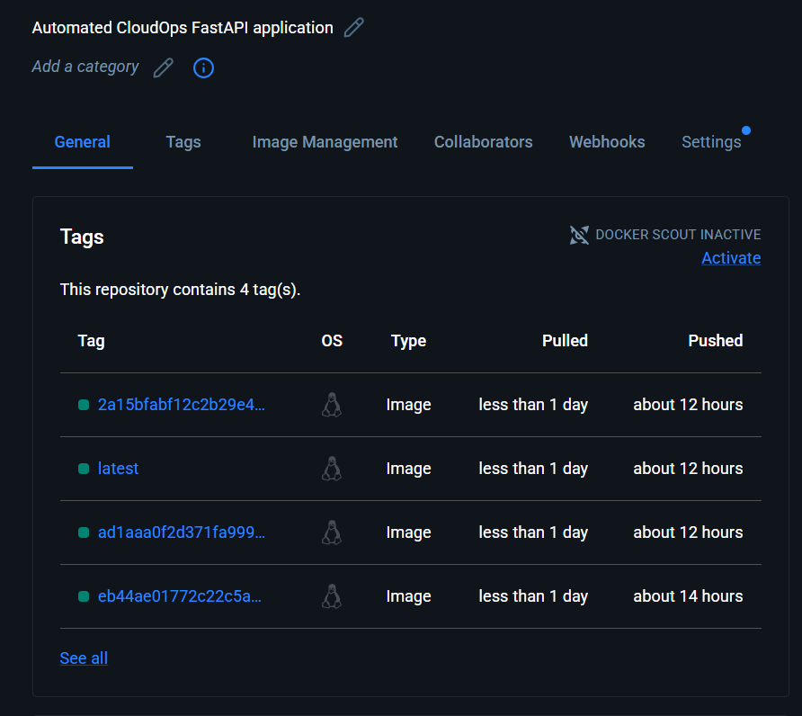
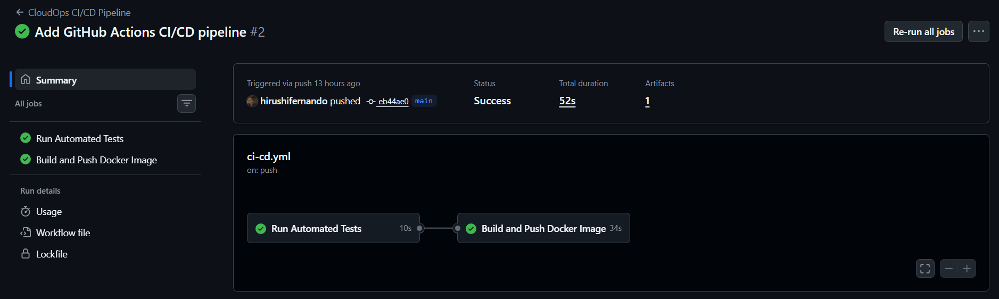
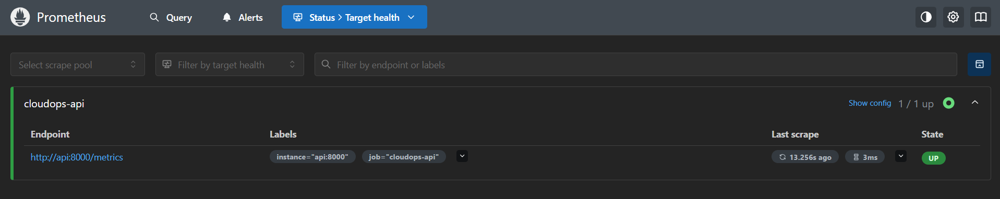
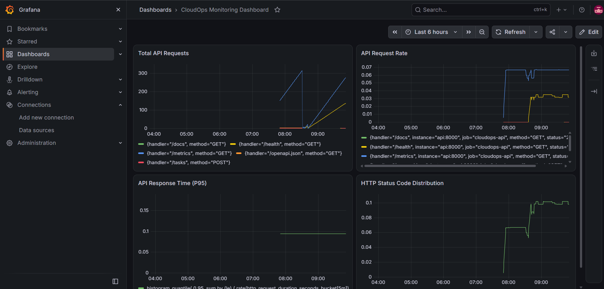
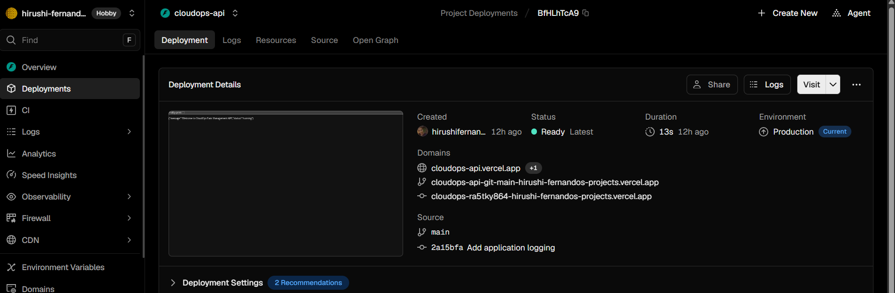

# CloudOps – Automated Cloud Deployment & Monitoring Platform

A beginner-to-intermediate Cloud and DevOps portfolio project demonstrating application development, automated testing, Docker containerization, CI/CD automation, cloud deployment, and monitoring.

## Project Overview

CloudOps is a Python-based task management REST API built with FastAPI and SQLite. The project demonstrates how application development can be combined with modern Cloud and DevOps practices.

It implements automated testing using Pytest, Docker containerization, GitHub Actions CI/CD, Docker Hub image publishing, cloud deployment through Vercel, and application monitoring using Prometheus and Grafana.

The project also includes application logging, health checks, environment-based configuration, test coverage reporting, and Docker image vulnerability scanning with Trivy.

## Architecture



## Technologies Used

| Category | Technologies |
|---|---|
| Backend | Python, FastAPI |
| Database | SQLite |
| API Testing | Pytest, HTTPX |
| Test Coverage | pytest-cov |
| Containerization | Docker, Docker Compose |
| Version Control | Git, GitHub |
| CI/CD | GitHub Actions |
| Container Registry | Docker Hub |
| Cloud Deployment | Vercel |
| Monitoring | Prometheus, Grafana |
| Security Scanning | Trivy |
| API Documentation | Swagger UI |
| Development Environment | Windows, VS Code |

## Main Features

### Application Development
- REST API development using FastAPI.
- Task management CRUD operations.
- SQLite database integration.
- Interactive API documentation through Swagger UI.

### Docker Containerization
- Custom Docker image creation.
- Dockerfile-based application containerization.
- Docker Compose multi-container environment.
- Named Docker volume for SQLite database storage.
- Docker health checks.
- Separate development and production configuration.

### CI/CD Automation
- Automated workflow using GitHub Actions.
- Automated Pytest execution.
- Docker image building.
- Automated Docker Hub publishing.
- Image tagging using `latest` and Git commit SHA.

### Cloud Deployment
- GitHub repository integration with Vercel.
- Automatic deployment from the GitHub `main` branch.
- Publicly accessible FastAPI application.

**Live Application:** https://cloudops-api.vercel.app/

**API Documentation:** https://cloudops-api.vercel.app/docs

### Monitoring and Observability
- Application logging.
- API health monitoring.
- Prometheus metrics endpoint.
- Prometheus metrics collection.
- Grafana monitoring dashboard.
- API request and response-time monitoring.
- HTTP status code monitoring.

### Container Security
- Docker image vulnerability scanning using Trivy.
- Identification of operating system and Python package vulnerabilities.
- Review of vulnerability severity and available fixes.

## CI/CD Workflow

The GitHub Actions pipeline automates testing and Docker image publishing.

1. Developer pushes code to the GitHub `main` branch.
2. GitHub Actions starts the CI/CD workflow.
3. Python dependencies are installed.
4. Pytest runs automated application tests.
5. After successful tests, the Docker image is built.
6. The image is published to Docker Hub.
7. The image is tagged with `latest` and the Git commit SHA.

### CI/CD Pipeline

**GitHub → GitHub Actions → Pytest → Docker Build → Docker Hub**

Vercel is independently connected to the GitHub repository and automatically deploys changes from the `main` branch. This deployment is not gated by the GitHub Actions test job.

## Monitoring Architecture

The local monitoring environment uses Docker Compose to run the API, Prometheus, and Grafana.

**Monitoring workflow:**

FastAPI `/metrics` → Prometheus → Grafana

### Grafana Dashboard

The CloudOps Monitoring Dashboard includes:

- Total API Requests
- API Request Rate
- API Response Time (P95)
- HTTP Status Code Distribution
- API Availability

Prometheus collects API metrics at regular intervals, while Grafana visualizes the collected information through monitoring panels.

## Project Structure

```text
CloudOps/
│
├── app/
│   ├── __init__.py
│   ├── main.py
│   └── database.py
│
├── tests/
│   ├── __init__.py
│   └── test_main.py
│
├── monitoring/
│   └── prometheus.yml
│
├── .github/
│   └── workflows/
│       └── ci-cd.yml
│
├── Dockerfile
├── compose.yaml
├── compose.dev.yaml
├── requirements.txt
├── requirements-lock.txt
├── .env.example
├── .dockerignore
├── .gitignore
├── architecture.png
└── README.md
```

## Running Locally

### Prerequisites

- Python 3.12
- Git
- Docker Desktop (for containerized execution)

### 1. Clone the repository

```bash
git clone https://github.com/hirushifernando/Automated-Cloud-Deployment-Monitoring-Platform.git

cd Automated-Cloud-Deployment-Monitoring-Platform
```

### 2. Create a virtual environment

```bash
python -m venv venv
```

### 3. Activate the virtual environment (Windows PowerShell)

```powershell
.\venv\Scripts\Activate.ps1
```

### 4. Install dependencies

```bash
pip install -r requirements.txt
```

### 5. Run the application

```bash
uvicorn app.main:app --reload
```

Open the following URLs:

- API: http://localhost:8000/
- Health Check: http://localhost:8000/health
- Swagger UI: http://localhost:8000/docs
- Metrics: http://localhost:8000/metrics

## Running with Docker Compose

Make sure Docker Desktop is running.

Start all services:

```bash
docker compose up -d --build
```

### Available Services

| Service | URL |
|---|---|
| FastAPI | http://localhost:8000 |
| Swagger UI | http://localhost:8000/docs |
| Prometheus | http://localhost:9090 |
| Grafana | http://localhost:3000 |

### Stop the services

```bash
docker compose down
```

The named SQLite data volume is preserved when using this command.

## Development Configuration

A separate development configuration is available through `compose.dev.yaml`.

To validate the merged configuration:

```bash
docker compose -f compose.yaml -f compose.dev.yaml config
```

To start with the development configuration:

```bash
docker compose -f compose.yaml -f compose.dev.yaml up -d --build
```

## Automated Testing

Run the test suite:

```bash
pytest -v
```

Run tests with coverage:

```bash
pytest --cov=app --cov-report=term-missing -v
```

### Test Results

- Automated tests: 10
- Tests passed: 10
- Application code coverage: 100%

The coverage report includes both `app/main.py` and `app/database.py`.

## Docker Image Security Scanning

Trivy was used to scan the Docker image for known vulnerabilities.

The scan examined:
- Operating system packages.
- Installed Python packages.
- Vulnerability severity levels.
- Available fixed versions.

The scan identified findings in packages including `zlib1g` and `pip`. These findings were reviewed as part of the project's container security assessment.

## Project Limitations

- The Vercel deployment uses SQLite, which does not provide persistent database storage across deployments or instances. It is intended as a demonstration deployment.
- Prometheus and Grafana are configured for local monitoring through Docker Compose.
- The local Prometheus configuration monitors the local API container, not the Vercel deployment.
- Docker Hub image publishing and Vercel deployment are separate workflows.
- The GitHub Actions test job does not currently act as a deployment approval gate for Vercel.
- The project is a learning and portfolio implementation rather than a production-grade cloud platform.

## Future Improvements

- AWS EC2 deployment.
- AWS Elastic Container Registry (ECR).
- Terraform infrastructure provisioning.
- AWS CloudWatch monitoring.
- PostgreSQL database integration.
- Automated container vulnerability scanning in CI/CD.
- Advanced DevSecOps integration.
- Secure cloud infrastructure automation.

## Screenshots

### API Documentation


### API Task Creation


### Docker Containers


### Docker Hub Repository


### GitHub Actions CI/CD Pipeline


### Prometheus Monitoring


### Grafana Monitoring Dashboard


### Vercel Cloud Deployment


## Author

**Hirushi Fernando**

Computer Science Graduate | AI & ML Enthusiast | Cloud & DevOps Learner
